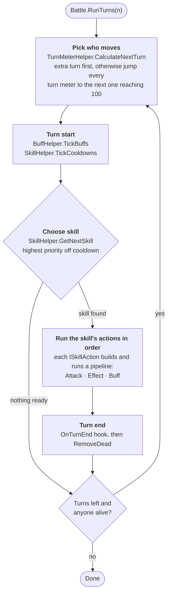
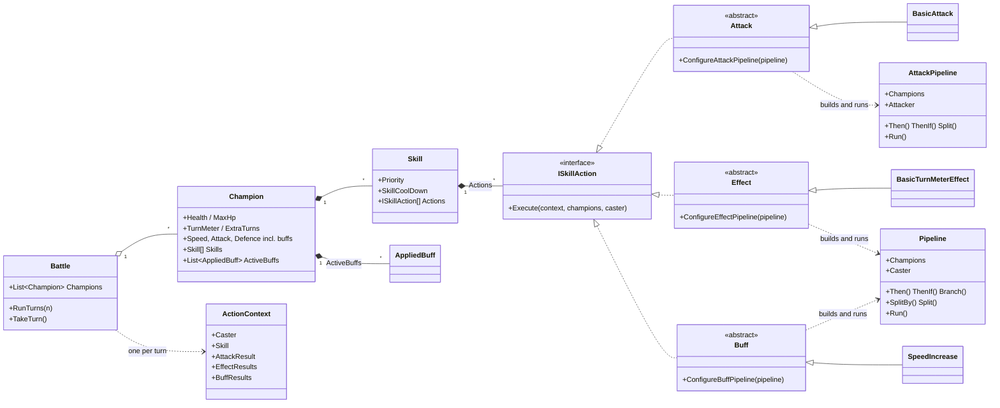
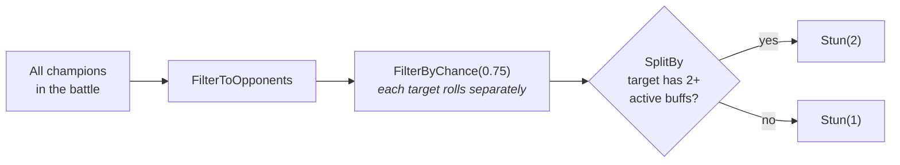
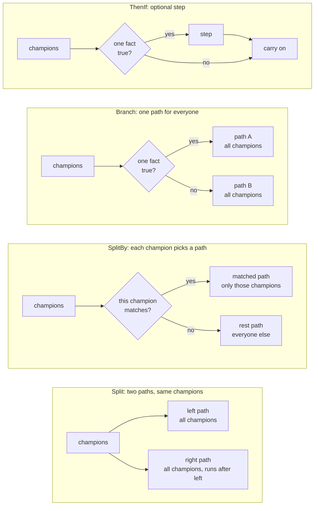

# Raid Calculator

A turn-order and battle simulator for **RAID: Shadow Legends** team building. Give it a
boss and a team of champions with their stats and skills, and it plays out the turns:
who moves when, which skill they use, and what damage, heals, buffs and turn meter
changes happen.

It's a console app written in C# (.NET 10).

> Fan-made tool. Not affiliated with or endorsed by Plarium.

## Running it

You need the [.NET 10 SDK](https://dotnet.microsoft.com/download).

```powershell
dotnet run --project RaidCalculator
```

The battle is set up in `RaidCalculator/Program.cs`. Each turn prints the turn meter of
every champion, coloured per champion, with the current boss turn count:

```text
----------------------------------------
Boss Turn: 1
champion:B, TM:109.5
champion:C, TM:42
champion:A, TM:18.9
```

## Setting up a battle

```csharp
var battle = new Battle(
[
    //            name speed TM  colour               skills                                          HP      DEF ATK mult damage type        C.RATE C.DMG isChampion
    new Champion("A", 90,   0, ConsoleColor.Green,  [Skills.EmptySkill()],                          100000, 294, 100, 0, DamageType.Health, 0.15, 1.5, false), // the boss
    new Champion("B", 150,  0, ConsoleColor.Yellow, [Skills.BoonOfSpeed(), Skills.SoothingChant()], 10000,  100, 100, 0, DamageType.Health, 2,    1.5),
    new Champion("C", 100,  0, ConsoleColor.Red,    [Skills.EmptySkill()],                          22800,  100, 100, 0, DamageType.Health, 2,    1.5),
]);

battle.RunTurns(10);
```

Set `isChampion` to `false` for the boss; its turns are what the "Boss Turn" counter
counts.

## How a turn works

1. **Turn meter.** Every tick, each champion gains `speed × 0.07` turn meter. The
   simulator jumps straight to the next tick where someone reaches 100, and the champion
   with the most turn meter goes. Extra turns are taken first.
2. **Turn start.** The acting champion's buffs and debuffs tick down (and expire at 0),
   and its skill cooldowns go down by one.
3. **Skill choice.** The champion uses its highest-priority skill that's off cooldown,
   which then goes on cooldown.
4. **Skill actions.** Each action on the skill runs in order: attacks, effects and buffs.
5. **Clean up.** Champions at 0 HP or below are removed from the battle.

Stats like speed, attack, defence, crit rate and crit damage are read through the active
buffs, so a `Speed Increase` changes turn order straight away.



## Architecture

A `Battle` holds the champions. Each champion has skills, and each skill is a list of
**actions**. Every action (`Attack`, `Effect` or `Buff`) implements `ISkillAction` and, when it
runs, builds a pipeline of steps that picks its targets and changes them: health, turn meter,
extra turns or active buffs. The `ActionContext` for the turn carries the caster, the skill
and the results.



Only one example of each action type is shown; the others follow the same pattern.

## Skills, effects and buffs

Skills live in `RaidCalculator/Collections/Skills.cs` and are lists of actions:

```csharp
public static Skill BoonOfSpeed() => new()
{
    Name = "BOON OF SPEED",
    SkillCoolDown = 5,
    Priority = 3,
    Actions = [new BasicTurnMeterEffect(), new SpeedIncrease(), new BasicAttack()]
};
```

| Kind | Folder | Included |
| --- | --- | --- |
| Attacks | `Attack/` | `BasicAttack` |
| Effects | `Effects/` | Fill all allies' turn meter by 15% (the advanced version also gives the caster an extra turn), chance to reduce buff durations, self heal, heal the lowest-HP ally (% of max HP) |
| Buffs / debuffs | `Buffs/` | Speed increase, defence increase, chance to stun |

### Pipelines

Every action builds a small **pipeline**: a list of steps that narrow down the targets and
then apply something to them. This keeps skill descriptions close to the in-game text.

```csharp
// "Fills the Turn Meter of all allies by 15%"
pipeline
    .Then(EffectSteps.FilterToAllies)
    .Then(p => EffectSteps.IncreaseTurnMeterForChampions(p, 15));
```

Each step either **narrows** the champion set (the filters) or **applies** something to
whoever is left. For example, the chance-to-stun buff (`ChancedStun`):



`Pipeline` has four ways to handle conditions:

| Method | Use it for | Example |
| --- | --- | --- |
| `ThenIf` | One optional step, based on one fact about the battle | "…if the caster is under [Increase DEF]" |
| `Branch` | Either/or: exactly one of two paths runs for everyone | "do X if any enemy is below 4000 HP, otherwise Y" |
| `SplitBy` | Each champion goes down one of two paths based on its own state | "Stun for 2 turns if it has 2+ buffs, otherwise 1" |
| `Split` | Two independent sets of steps over the same champions | "do three things to poisoned enemies, and damage all enemies" |



The comments in `Pipeline.cs` explain when to use which, and the mistakes to avoid.
`AttackPipeline` works the same way for attacks, with `Then`, `ThenIf` and a `Split` that
divides targets into champions and the boss by default.

## Project layout

```text
RaidCalculator/
├── Program.cs            Battle setup
├── Battle.cs             Turn loop
├── Pipeline.cs           Pipeline steps and branching
├── Attack/               Attacks and damage steps
├── Buffs/                Buffs, debuffs and their steps
├── Effects/              Turn meter, heals and other effects
├── Collections/Skills.cs Skill definitions
├── Helpers/              Turn meter, skills, buffs and console output
└── Models/               Champion, Skill, results and enums
```

## Adding a skill

1. Make any new effect or buff by subclassing `Effect` or `Buff` and building its pipeline
   from the existing steps (`EffectSteps`, `BuffSteps`, `AttackSteps`).
2. Add the skill to `Collections/Skills.cs` with its cooldown, priority and actions.
3. Give it to a champion in `Program.cs` and run.

## Status

Work in progress. The turn meter engine, skill cooldowns and priorities, basic attacks,
heals, turn meter effects and a few buffs work. There's a hook in `Battle.OnTurnEnd` for
end-of-turn effects such as Relentless and gear sets, which aren't in yet.
